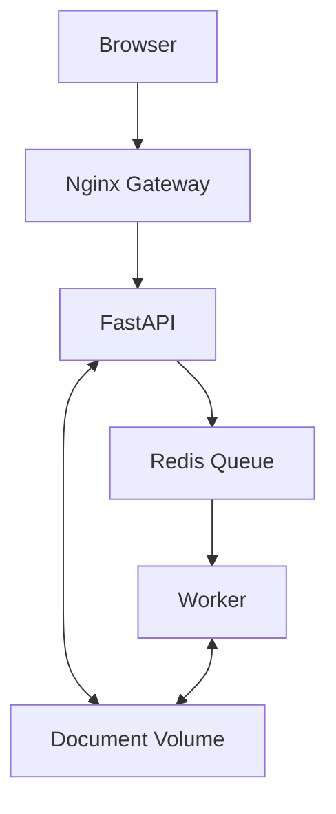

# DocFlow

[](https://github.com/TranKiet146/docflow_SOA_Seminar/actions/workflows/ci.yml)

DocFlow is an asynchronous document processing application built to
demonstrate Docker Compose multi-container deployment, service discovery,
network isolation, persistent storage, background processing and failure
recovery.

## Use case

A user uploads a TXT or Markdown document through a browser.

DocFlow stores the document, creates an asynchronous job in Redis Queue,
processes it with a background Worker and generates JSON and HTML reports.

The report contains:

- Word count
- Line count
- Character count
- Estimated reading time
- Frequent terms
- SHA-256 checksum

## Architecture



Only the Nginx Gateway publishes a host port.

| Service       | Responsibility                       | Network               |
| ------------- | ------------------------------------ | --------------------- |
| Nginx Gateway | Web UI and reverse proxy             | `edge-net`            |
| FastAPI       | Validation, storage and job creation | `edge-net`, `job-net` |
| Redis         | Queue and job state                  | `job-net`             |
| Worker        | Background document processing       | `job-net`             |
| Smoke test    | End-to-end verification              | `edge-net`            |

## Requirements

- Docker Desktop
- Docker Compose
- Git
- PowerShell for recovery demonstrations

## Run locally

Build and start the application:

```bash
docker compose up -d --build
```

Check service status:

```bash
docker compose ps
```

Open the web interface:

```text
http://localhost:8080
```

Open FastAPI documentation through Nginx:

```text
http://localhost:8080/docs
```

Stop the application:

```bash
docker compose down
```

Persistent named volumes are retained unless `--volumes` is supplied.

## Automated verification

Run the containerized end-to-end smoke test:

```bash
docker compose --profile test run --rm smoke-test
```

The test verifies:

- Gateway health
- Nginx reverse proxy
- API information
- Network isolation
- Upload validation
- Queue creation
- Worker processing
- JSON report contents
- HTML report download

## Failure recovery demonstrations

Verify Worker outage recovery on Windows:

```powershell
powershell -ExecutionPolicy Bypass `
  -File .\scripts\test-recovery.ps1
```

Verify Redis dependency recovery:

```powershell
powershell -ExecutionPolicy Bypass `
  -File .\scripts\test-redis-recovery.ps1
```

## Worker scaling

Scale to three Worker containers:

```bash
docker compose up -d --scale worker=3
docker compose ps
```

Return to one Worker:

```bash
docker compose up -d --scale worker=1
```

## Continuous integration

GitHub Actions automatically performs the following for every push and pull
request to `main`:

1. Validate the Docker Compose configuration
2. Validate Python test syntax
3. Build application images
4. Start the complete stack
5. Wait for Gateway health
6. Run the end-to-end smoke test
7. Collect diagnostic logs after failure
8. Remove containers and test volumes

## Project status

Completed:

- Milestone 1 — Project foundation
- Milestone 2 — Upload and Redis Queue
- Milestone 3 — Worker and generated reports
- Milestone 4 — Nginx Gateway and browser interface
- Milestone 5 — Integration and recovery testing
- Milestone 6 — GitHub Actions continuous integration

Current:

- Milestone 7 — Architecture and seminar documentation

## Documentation

- [Project scope](docs/scope.md)
- [Architecture](docs/architecture.md)
- [Project progress](docs/progress.md)
- [Seminar demonstration](docs/demo.md)

## Scope exclusions

The following are intentionally outside the seminar scope:

- User authentication
- PDF and Office document parsing
- Kubernetes
- Multi-host deployment
- Production monitoring
