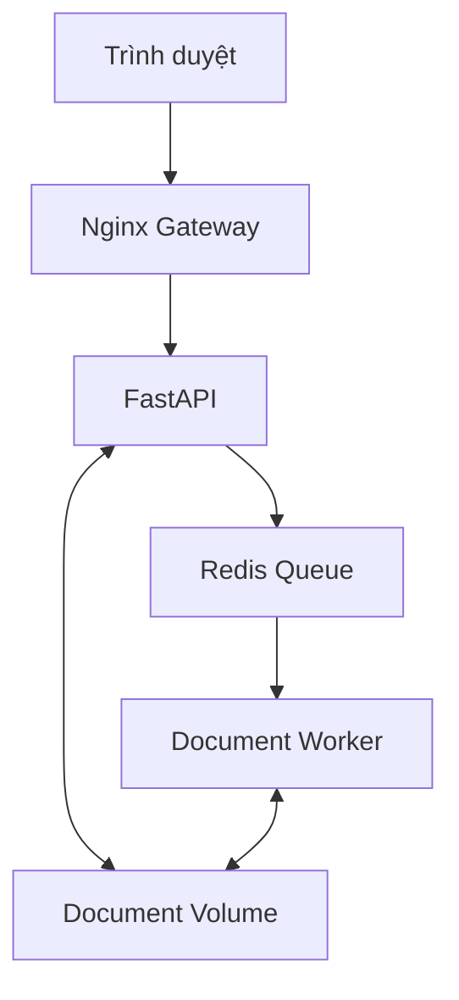

# DocFlow

[](https://github.com/TranKiet146/docflow_SOA_Seminar/actions/workflows/ci.yml)
[](https://github.com/TranKiet146/docflow_SOA_Seminar/actions/workflows/release.yml)

DocFlow là ứng dụng xử lý tài liệu bất đồng bộ, được xây dựng để minh họa
cách triển khai hệ thống nhiều container bằng Docker Compose.

Tài liệu này dành cho người mới bắt đầu, kể cả khi máy tính hiện tại chỉ có
Visual Studio Code và chưa cài Git, Docker, Python, Redis hay Nginx.

Phiên bản hiện tại: **v0.5.0**

---

## 1. Sau khi hoàn thành hướng dẫn này, bạn sẽ làm được gì?

Bạn sẽ có thể:

- Tải mã nguồn DocFlow từ GitHub.
- Chạy toàn bộ hệ thống bằng một lệnh Docker Compose.
- Upload tài liệu TXT hoặc Markdown trên trình duyệt.
- Theo dõi quá trình xử lý bất đồng bộ.
- Xem kết quả phân tích tài liệu.
- Tải báo cáo HTML.
- Quan sát log của từng service.
- Chạy kiểm thử tự động.
- Thử nghiệm lỗi Worker và Redis.
- Scale nhiều Worker.
- Chạy phiên bản phát hành từ GitHub Container Registry.
- Hiểu cơ bản về CI/CD bằng GitHub Actions.

Bạn **không cần cài Python, Redis hoặc Nginx trực tiếp trên Windows**.
Các thành phần đó đều chạy bên trong Docker container.

---

## 2. DocFlow giải quyết vấn đề gì?

Giả sử người dùng tải lên một tài liệu cần phân tích.

Nếu API xử lý toàn bộ tài liệu ngay trong HTTP request:

- Người dùng phải chờ request rất lâu.
- API không thể phục vụ nhiều người dùng hiệu quả.
- Nếu tiến trình xử lý gặp lỗi, request có thể bị mất.
- Việc mở rộng số lượng tiến trình xử lý trở nên khó khăn.

DocFlow giải quyết vấn đề bằng cách tách việc tiếp nhận request và việc xử lý
tài liệu thành hai quá trình khác nhau.

Luồng xử lý:

1. Người dùng upload tài liệu.
2. FastAPI kiểm tra và lưu tài liệu.
3. FastAPI tạo một job trong Redis Queue.
4. API trả về `202 Accepted` ngay cho người dùng.
5. Worker lấy job từ Redis.
6. Worker phân tích tài liệu.
7. Worker tạo báo cáo JSON và HTML.
8. Người dùng xem hoặc tải kết quả.

Đây là mô hình:

```text
Producer → Queue → Consumer
```

Trong DocFlow:

| Vai trò | Thành phần |
|---|---|
| Producer | FastAPI |
| Queue | Redis Queue |
| Consumer | Worker |

---

## 3. Kiến trúc hệ thống



Chỉ Nginx Gateway công khai cổng ra máy tính người dùng.

Các service nội bộ không được truy cập trực tiếp từ bên ngoài.

| Service | Chức năng | Docker network |
|---|---|---|
| Nginx Gateway | Giao diện web và reverse proxy | `edge-net` |
| FastAPI | Nhận file, validation và tạo job | `edge-net`, `job-net` |
| Redis | Lưu queue và trạng thái job | `job-net` |
| Worker | Xử lý tài liệu trong nền | `job-net` |
| Smoke test | Kiểm tra toàn bộ luồng hệ thống | `edge-net` |

---

## 4. Giải thích các khái niệm cơ bản

Nếu bạn chưa từng sử dụng Docker, hãy hiểu các thuật ngữ sau trước khi chạy
dự án.

### 4.1 Docker image

Image là khuôn mẫu chứa:

- Mã nguồn
- Runtime
- Thư viện
- Cấu hình cần thiết để chạy ứng dụng

Ví dụ:

```text
docflow-backend:0.5.0
```

là image chứa FastAPI, RQ Worker và các thư viện Python.

### 4.2 Docker container

Container là một tiến trình đang chạy được tạo từ image.

Một image có thể tạo nhiều container.

Ví dụ, ba Worker có thể cùng chạy từ một backend image.

### 4.3 Docker Compose

Docker Compose đọc file `compose.yaml` và quản lý nhiều container như một hệ
thống duy nhất.

Thay vì khởi động từng service thủ công, ta chỉ cần:

```powershell
docker compose up -d
```

### 4.4 Volume

Volume là vùng lưu dữ liệu bền vững do Docker quản lý.

DocFlow sử dụng:

| Volume | Mục đích |
|---|---|
| `redis-data` | Lưu dữ liệu Redis |
| `document-data` | Lưu file upload và báo cáo |

Container có thể bị tạo lại nhưng dữ liệu trong volume vẫn còn.

### 4.5 Docker network

Network cho phép các container liên lạc với nhau bằng tên service.

Ví dụ, FastAPI kết nối Redis qua:

```text
redis://redis:6379/0
```

Trong đó `redis` là tên service, không phải địa chỉ IP cố định.

### 4.6 Reverse proxy

Trình duyệt chỉ kết nối Nginx Gateway.

Nginx chuyển tiếp request `/api` đến FastAPI ở bên trong Docker network.

```text
Browser → Nginx → FastAPI
```

### 4.7 Healthcheck

Healthcheck giúp Docker xác định service có hoạt động đúng hay không.

Ví dụ:

- Gateway kiểm tra endpoint `/health`.
- API kiểm tra khả năng kết nối Redis.
- Redis kiểm tra bằng lệnh `PING`.

### 4.8 CI/CD

**Continuous Integration — CI**:

- Chạy khi push code.
- Build hệ thống.
- Chạy kiểm thử.
- Phát hiện lỗi sớm.

**Continuous Delivery — CD**:

- Chạy khi push tag phiên bản.
- Build Docker image phát hành.
- Đưa image lên GitHub Container Registry.
- Image sẵn sàng để triển khai.

---

# Phần I — Chuẩn bị máy tính

## 5. Yêu cầu hệ thống

Hướng dẫn này ưu tiên:

- Windows 10 hoặc Windows 11 64-bit
- Visual Studio Code
- Kết nối Internet
- Quyền cài đặt phần mềm trên máy

Nếu máy hiện tại chỉ có VS Code, bạn cần cài thêm:

1. Git
2. Docker Desktop

Bạn không cần cài riêng:

- Python
- FastAPI
- Redis
- Nginx

---

## 6. Mở Terminal trong VS Code

Trong Visual Studio Code:

1. Chọn menu **Terminal**.
2. Chọn **New Terminal**.
3. Kiểm tra terminal đang sử dụng PowerShell.

Terminal thường hiển thị dạng:

```text
PS C:\Users\YourName>
```

Tất cả lệnh Windows trong README này được chạy trong terminal PowerShell của
VS Code.

Tài liệu chính thức:

- [VS Code Integrated Terminal](https://code.visualstudio.com/docs/terminal/basics)

---

## 7. Cài Git

Git được dùng để tải mã nguồn và quản lý phiên bản.

### 7.1 Tải Git

Truy cập:

- [Git for Windows](https://git-scm.com/downloads/win)

Tải và chạy trình cài đặt.

Nếu chưa biết chọn gì, có thể giữ các lựa chọn mặc định của trình cài đặt.

### 7.2 Khởi động lại VS Code

Sau khi cài Git:

1. Đóng hoàn toàn VS Code.
2. Mở lại VS Code.
3. Mở terminal mới.

### 7.3 Kiểm tra Git

```powershell
git --version
```

Kết quả hợp lệ có dạng:

```text
git version 2.x.x.windows.x
```

Nếu nhận lỗi:

```text
git is not recognized
```

hãy khởi động lại VS Code hoặc Windows.

---

## 8. Cài Docker Desktop

Docker Desktop cung cấp Docker Engine và Docker Compose.

### 8.1 Tải Docker Desktop

Truy cập:

- [Install Docker Desktop on Windows](https://docs.docker.com/desktop/setup/install/windows-install/)

Tải bản dành cho Windows và chạy trình cài đặt.

### 8.2 Chọn WSL 2

Khi trình cài đặt hỏi backend, chọn WSL 2 nếu máy hỗ trợ.

Nếu Windows yêu cầu cập nhật WSL, mở PowerShell bằng quyền Administrator và
chạy:

```powershell
wsl --update
```

Sau đó khởi động lại Windows.

### 8.3 Khởi động Docker Desktop

1. Mở Docker Desktop.
2. Chấp nhận điều khoản nếu được hỏi.
3. Chờ đến khi Docker Desktop báo Engine đang chạy.

Không đóng Docker Desktop trong lúc sử dụng DocFlow.

### 8.4 Kiểm tra Docker

Mở lại terminal VS Code:

```powershell
docker --version
docker compose version
```

Kết quả hợp lệ có dạng:

```text
Docker version ...
Docker Compose version v...
```

Kiểm tra Docker Engine:

```powershell
docker info
```

Nếu lệnh này hiển thị thông tin Client và Server thì Docker đã sẵn sàng.

Nếu nhận lỗi:

```text
Cannot connect to the Docker daemon
```

hãy mở Docker Desktop và chờ Engine khởi động hoàn toàn.

---

# Phần II — Tải và mở dự án

## 9. Chọn thư mục lưu dự án

Ví dụ, bạn muốn lưu dự án tại:

```text
C:\IT Learn\Seminar_SOA
```

Trong terminal VS Code:

```powershell
cd "C:\IT Learn\Seminar_SOA"
```

Nếu thư mục chưa tồn tại:

```powershell
New-Item `
  -ItemType Directory `
  -Force `
  "C:\IT Learn\Seminar_SOA"

cd "C:\IT Learn\Seminar_SOA"
```

Bạn có thể thay đường dẫn trên bằng thư mục khác trên máy.

Dấu ngoặc kép là cần thiết nếu đường dẫn chứa khoảng trắng.

---

## 10. Clone repository

Chạy:

```powershell
git clone `
  https://github.com/TranKiet146/docflow_SOA_Seminar.git
```

Đi vào thư mục dự án:

```powershell
cd .\docflow_SOA_Seminar
```

Kiểm tra:

```powershell
git status
```

Kết quả mong đợi:

```text
On branch main
Your branch is up to date with 'origin/main'.
nothing to commit, working tree clean
```

---

## 11. Mở dự án trong VS Code

Nếu lệnh `code` khả dụng:

```powershell
code .
```

Nếu lệnh `code` không khả dụng:

1. Mở VS Code.
2. Chọn **File → Open Folder**.
3. Chọn thư mục `docflow_SOA_Seminar`.
4. Chọn **Select Folder**.
5. Mở terminal mới bằng **Terminal → New Terminal**.

Đảm bảo terminal đang đứng đúng thư mục:

```powershell
Get-Location
```

Kết quả phải kết thúc bằng:

```text
docflow_SOA_Seminar
```

---

## 12. Cấu trúc repository

```text
docflow_SOA_Seminar/
├── .github/
│   └── workflows/
│       ├── ci.yml
│       └── release.yml
├── backend/
│   ├── app/
│   │   ├── main.py
│   │   └── tasks.py
│   ├── Dockerfile
│   └── requirements.txt
├── gateway/
│   ├── static/
│   │   └── index.html
│   ├── Dockerfile
│   └── nginx.conf
├── scripts/
│   ├── test-recovery.ps1
│   └── test-redis-recovery.ps1
├── tests/
│   └── tests.py
├── docs/
│   ├── architecture.md
│   ├── demo.md
│   ├── progress.md
│   └── scope.md
├── .env.example
├── compose.yaml
├── compose.release.yaml
└── README.md
```

Vai trò các file chính:

| File | Chức năng |
|---|---|
| `compose.yaml` | Định nghĩa hệ thống chạy local |
| `compose.release.yaml` | Ghi đè image khi chạy bản phát hành |
| `.env.example` | Các biến cấu hình mẫu |
| `backend/app/main.py` | API, healthcheck và job endpoints |
| `backend/app/tasks.py` | Logic xử lý tài liệu |
| `gateway/nginx.conf` | Cấu hình reverse proxy |
| `gateway/static/index.html` | Giao diện trình duyệt |
| `tests/tests.py` | Smoke test end-to-end |
| `scripts/*.ps1` | Kiểm thử phục hồi sự cố |

---

# Phần III — Chạy dự án lần đầu

## 13. Tạo file cấu hình `.env`

Copy file mẫu:

```powershell
Copy-Item .env.example .env
```

Mở `.env` trong VS Code.

Nội dung mặc định:

```dotenv
APP_PORT=8080

REDIS_URL=redis://redis:6379/0
QUEUE_NAME=document-jobs

UPLOAD_DIR=/data/uploads
RESULT_DIR=/data/results

MAX_UPLOAD_MB=2
JOB_TIMEOUT_SECONDS=60
RESULT_TTL_SECONDS=86400
```

Ý nghĩa:

| Biến | Ý nghĩa |
|---|---|
| `APP_PORT` | Cổng mở trên máy người dùng |
| `REDIS_URL` | Địa chỉ Redis trong Docker network |
| `QUEUE_NAME` | Tên hàng đợi |
| `UPLOAD_DIR` | Nơi lưu file upload trong container |
| `RESULT_DIR` | Nơi lưu báo cáo |
| `MAX_UPLOAD_MB` | Dung lượng upload tối đa |
| `JOB_TIMEOUT_SECONDS` | Thời gian tối đa của job |
| `RESULT_TTL_SECONDS` | Thời gian Redis giữ kết quả job |

Không thay `REDIS_URL` thành `localhost`. Bên trong Docker network, API phải kết
nối Redis bằng tên service `redis`.

File `.env` đã được `.gitignore` loại trừ và không nên commit.

---

## 14. Kiểm tra cấu hình Compose

```powershell
docker compose config --quiet
```

Nếu không có output, cấu hình hợp lệ.

Xem cấu hình đã được Docker xử lý:

```powershell
docker compose config
```

---

## 15. Build và khởi động

Đảm bảo Docker Desktop đang chạy, sau đó:

```powershell
docker compose up -d --build
```

Ý nghĩa:

- `up`: tạo và khởi động service.
- `-d`: chạy nền để terminal vẫn sử dụng được.
- `--build`: build lại image từ Dockerfile.

Lần build đầu tiên có thể mất vài phút vì Docker phải tải base image và cài
thư viện.

Không đóng Docker Desktop hoặc ngắt mạng trong lần build đầu tiên.

---

## 16. Kiểm tra trạng thái container

```powershell
docker compose ps
```

Kết quả mong đợi có bốn service chính:

| Service | Trạng thái mong đợi |
|---|---|
| `gateway` | `healthy` |
| `api` | `healthy` |
| `redis` | `healthy` |
| `worker` | `running` |

Ví dụ:

```text
NAME                SERVICE   STATUS
docflow-gateway-1   gateway   Up (healthy)
docflow-api-1       api       Up (healthy)
docflow-redis-1     redis     Up (healthy)
docflow-worker-1    worker    Up
```

Worker không có healthcheck riêng nên chỉ hiển thị `Up`, không hiển thị
`healthy`. Đây là trạng thái đúng.

Nếu service đang ở `health: starting`, chờ khoảng 10 giây rồi chạy lại:

```powershell
docker compose ps
```

---

## 17. Mở giao diện

Mở trình duyệt:

```powershell
Start-Process http://localhost:8080
```

Hoặc nhập trực tiếp:

```text
http://localhost:8080
```

Nếu bạn đã đổi `APP_PORT=8081`, hãy dùng:

```text
http://localhost:8081
```

---

## 18. Upload tài liệu đầu tiên

Trên giao diện DocFlow:

1. Chọn **Select a document**.
2. Chọn file `.txt` hoặc `.md`.
3. Nhấn **Process document**.
4. Theo dõi trạng thái job.
5. Chờ trạng thái `finished`.
6. Xem các chỉ số.
7. Nhấn **Download HTML** để tải báo cáo.

Nếu chưa có file mẫu, tạo bằng PowerShell:

```powershell
@"
# DocFlow sample

Docker Compose starts multiple services.
Redis stores asynchronous jobs.
The Worker processes documents in the background.
"@ | Set-Content `
  -Encoding utf8 `
  .\docflow-sample.md
```

Sau đó upload file `docflow-sample.md`.

Không cần đưa file mẫu này lên Git.

Xóa khi không còn dùng:

```powershell
Remove-Item .\docflow-sample.md
```

---

## 19. Mở API documentation

DocFlow cung cấp Swagger UI thông qua Nginx:

```powershell
Start-Process http://localhost:8080/docs
```

Tại đây có thể xem:

- `GET /api/info`
- `POST /api/jobs`
- `GET /api/jobs/{job_id}`
- `GET /api/jobs/{job_id}/result`
- `GET /api/jobs/{job_id}/download`

---

# Phần IV — Quan sát hệ thống

## 20. Xem log

Xem log tất cả service:

```powershell
docker compose logs
```

Theo dõi log theo thời gian thực:

```powershell
docker compose logs -f
```

Theo dõi một service:

```powershell
docker compose logs -f api
docker compose logs -f worker
docker compose logs -f gateway
docker compose logs -f redis
```

Nhấn `Ctrl+C` để thoát chế độ theo dõi.

`Ctrl+C` chỉ dừng việc hiển thị log, không dừng container đang chạy nền.

---

## 21. Kiểm tra Gateway

```powershell
Invoke-WebRequest `
  http://localhost:8080/health
```

Kết quả phải có status code `200`.

Xem nội dung:

```powershell
(Invoke-WebRequest `
  http://localhost:8080/health).Content
```

Kết quả:

```text
gateway ok
```

---

## 22. Kiểm tra API qua Nginx

```powershell
Invoke-RestMethod `
  http://localhost:8080/api/info |
  ConvertTo-Json -Depth 5
```

Kết quả chứa:

```json
{
  "service": "docflow-api",
  "version": "0.5.0"
}
```

---

## 23. Kiểm tra network isolation

Gateway có thể truy cập API:

```powershell
docker compose exec gateway `
  wget -qO- http://api:8000/api/info
```

Gateway không thể phân giải Redis:

```powershell
docker compose exec gateway `
  getent hosts redis
```

Lệnh thứ hai không trả địa chỉ Redis là kết quả mong đợi.

Điều này chứng minh Gateway và Redis không nằm chung Docker network.

---

## 24. Kiểm tra dữ liệu trong volume

Xem file upload:

```powershell
docker compose exec api `
  ls -la /data/uploads
```

Xem báo cáo:

```powershell
docker compose exec api `
  ls -la /data/results
```

Xem các volume:

```powershell
docker volume ls
```

---

# Phần V — Kiểm thử

## 25. Chạy smoke test

Smoke test kiểm tra toàn bộ luồng:

```text
Test container → Gateway → API → Redis → Worker → Report
```

Chạy:

```powershell
docker compose `
  --profile test `
  run --rm smoke-test
```

Kết quả thành công:

```text
[smoke-test] PASS gateway health
[smoke-test] PASS API information through Nginx
[smoke-test] PASS Redis is isolated from edge-net
[smoke-test] PASS unsupported upload rejected
[smoke-test] PASS upload accepted
[smoke-test] PASS Worker completed queued job
[smoke-test] PASS JSON report contents
[smoke-test] PASS HTML report download
[smoke-test] ALL SMOKE TESTS PASSED
```

`--rm` xóa test container sau khi chạy xong. Các service chính vẫn tiếp tục
hoạt động.

---

## 26. Kiểm thử Worker recovery

Chạy:

```powershell
powershell -ExecutionPolicy Bypass `
  -File .\scripts\test-recovery.ps1
```

Script tự động:

1. Dừng Worker.
2. Upload một tài liệu.
3. Xác nhận job vẫn nằm trong queue.
4. Khởi động Worker.
5. Chờ job hoàn thành.
6. Khôi phục Worker nếu test gặp lỗi.

Kết quả:

```text
ALL WORKER RECOVERY TESTS PASSED
```

---

## 27. Kiểm thử Redis recovery

```powershell
powershell -ExecutionPolicy Bypass `
  -File .\scripts\test-redis-recovery.ps1
```

Script tự động:

1. Dừng Redis.
2. Xác nhận API trả `503 Service Unavailable`.
3. Khởi động Redis.
4. Chờ API readiness phục hồi.
5. Upload tài liệu mới.
6. Xác nhận job hoàn thành.
7. Khôi phục service nếu test gặp lỗi.

Kết quả:

```text
ALL REDIS RECOVERY TESTS PASSED
```

Sau hai bài test:

```powershell
docker compose ps
```

Đảm bảo các service đã hoạt động trở lại.

---

# Phần VI — Scale và phục hồi

## 28. Scale Worker

Chạy ba Worker:

```powershell
docker compose up -d --scale worker=3
```

Kiểm tra:

```powershell
docker compose ps
```

Bạn sẽ thấy:

```text
docflow-worker-1
docflow-worker-2
docflow-worker-3
```

Worker không publish host port nên các replica không xung đột cổng.

Đưa về một Worker:

```powershell
docker compose up -d --scale worker=1
```

---

## 29. Dừng và khởi động lại

Dừng container nhưng không xóa:

```powershell
docker compose stop
```

Khởi động lại:

```powershell
docker compose start
```

Xóa container và network nhưng giữ volume:

```powershell
docker compose down
```

Khởi động lại sau khi `down`:

```powershell
docker compose up -d
```

---

## 30. Xóa toàn bộ dữ liệu

> Cảnh báo: lệnh sau xóa cả Redis data, file upload và báo cáo.

```powershell
docker compose down --volumes
```

Chỉ chạy khi bạn thực sự muốn reset toàn bộ môi trường.

Sau đó build lại:

```powershell
docker compose up -d --build
```

---

# Phần VII — Chạy bản phát hành

## 31. Local build và release image khác nhau thế nào?

Chạy local:

```powershell
docker compose up -d --build
```

Docker build image từ mã nguồn trên máy.

Chạy release:

```powershell
docker compose `
  -f compose.yaml `
  -f compose.release.yaml `
  up -d --no-build
```

Docker dùng image đã được CD phát hành lên GitHub Container Registry.

---

## 32. Chạy phiên bản `v0.5.0`

Dừng hệ thống hiện tại:

```powershell
docker compose down
```

Chọn phiên bản:

```powershell
$env:DOCFLOW_VERSION = "0.5.0"
```

Tải image phát hành:

```powershell
docker compose `
  -f compose.yaml `
  -f compose.release.yaml `
  pull gateway api worker
```

Khởi động mà không build local:

```powershell
docker compose `
  -f compose.yaml `
  -f compose.release.yaml `
  up -d --no-build
```

Kiểm tra:

```powershell
docker compose `
  -f compose.yaml `
  -f compose.release.yaml `
  ps
```

Chạy smoke test:

```powershell
docker compose `
  -f compose.yaml `
  -f compose.release.yaml `
  --profile test `
  run --rm smoke-test
```

---

# Phần VIII — CI/CD

## 33. Continuous Integration

Workflow:

```text
.github/workflows/ci.yml
```

CI chạy khi:

- Push vào `main`
- Tạo pull request vào `main`
- Chạy thủ công bằng `workflow_dispatch`

CI thực hiện:

1. Checkout repository.
2. Kiểm tra Docker Compose.
3. Kiểm tra cú pháp Python.
4. Build image.
5. Khởi động hệ thống.
6. Chờ Gateway healthy.
7. Chạy smoke test.
8. In log nếu thất bại.
9. Dọn test environment.

Xem workflow:

- [DocFlow CI](https://github.com/TranKiet146/docflow_SOA_Seminar/actions/workflows/ci.yml)

---

## 34. Continuous Delivery

Workflow:

```text
.github/workflows/release.yml
```

CD chạy khi push tag dạng:

```text
v0.5.0
```

CD thực hiện:

1. Build backend image.
2. Build Gateway image.
3. Tạo metadata từ version tag.
4. Tạo provenance và SBOM.
5. Push image lên GitHub Container Registry.
6. Tạo các tag `0.5.0`, `0.5` và `latest`.

Images:

```text
ghcr.io/trankiet146/docflow-backend:0.5.0
ghcr.io/trankiet146/docflow-gateway:0.5.0
```

Xem workflow:

- [DocFlow CD](https://github.com/TranKiet146/docflow_SOA_Seminar/actions/workflows/release.yml)

Đây là Continuous Delivery, không phải Continuous Deployment, vì artifact
được phát hành tự động nhưng việc triển khai vẫn do người vận hành quyết định.

---

# Phần IX — Xử lý lỗi thường gặp

## 35. `docker` không được nhận diện

Lỗi:

```text
docker is not recognized
```

Cách xử lý:

1. Kiểm tra Docker Desktop đã được cài.
2. Đóng và mở lại VS Code.
3. Khởi động lại Windows nếu cần.
4. Chạy lại:

```powershell
docker --version
```

---

## 36. Không kết nối được Docker daemon

Lỗi:

```text
Cannot connect to the Docker daemon
```

Cách xử lý:

1. Mở Docker Desktop.
2. Chờ Docker Engine chạy.
3. Kiểm tra:

```powershell
docker info
```

---

## 37. Cổng `8080` đang được sử dụng

Kiểm tra:

```powershell
Get-NetTCPConnection `
  -LocalPort 8080 `
  -ErrorAction SilentlyContinue
```

Đổi trong `.env`:

```dotenv
APP_PORT=8081
```

Tạo lại Gateway:

```powershell
docker compose up -d --force-recreate gateway
```

Truy cập:

```text
http://localhost:8081
```

---

## 38. Gateway `unhealthy`

Kiểm tra:

```powershell
docker compose logs gateway
```

Xem health history:

```powershell
docker inspect docflow-gateway-1 `
  --format '{{json .State.Health}}'
```

Kiểm tra endpoint bên trong container:

```powershell
docker compose exec gateway `
  wget -qO- http://127.0.0.1/health
```

Kết quả đúng:

```text
gateway ok
```

---

## 39. API `unhealthy`

Kiểm tra Redis:

```powershell
docker compose ps redis
docker compose logs redis
```

Kiểm tra API:

```powershell
docker compose logs api
```

Khởi động lại Redis và API:

```powershell
docker compose restart redis
docker compose up -d api
```

---

## 40. Build lỗi

Xem log đầy đủ:

```powershell
docker compose build --no-cache
```

Nếu nghi ngờ cache hỏng:

```powershell
docker builder prune
```

Lệnh trên chỉ nên chạy khi cần vì sẽ xóa build cache.

Sau đó:

```powershell
docker compose up -d --build
```

---

## 41. Smoke test không chạy đúng file

Compose hiện chạy:

```text
/tests/tests.py
```

File local tương ứng:

```text
tests/tests.py
```

Kiểm tra:

```powershell
Get-ChildItem .\tests
```

Không nên đồng thời tạo cả `tests.py` và `smoke_test.py`.

---

## 42. Xem toàn bộ trạng thái để chẩn đoán

```powershell
docker compose ps
docker compose logs --tail=100
git status
```

Ba lệnh này thường cung cấp đủ thông tin ban đầu để xác định lỗi.

---

# Phần X — Trạng thái và tài liệu

## 43. Trạng thái dự án

Đã hoàn thành:

- Milestone 1 — Project foundation
- Milestone 2 — Upload và Redis Queue
- Milestone 3 — Worker và generated reports
- Milestone 4 — Nginx Gateway và browser interface
- Milestone 5 — Integration và recovery testing
- Milestone 6 — GitHub Actions Continuous Integration
- Milestone 7 — GHCR Continuous Delivery
- Release `v0.5.0`
- Architecture documentation
- Seminar demonstration guide

Đang thực hiện:

- Slide thuyết trình
- Lời thoại demo
- Bộ câu hỏi phản biện
- Tổng duyệt seminar

---

## 44. Tài liệu bổ sung

- [Phạm vi dự án](docs/scope.md)
- [Kiến trúc hệ thống](docs/architecture.md)
- [Tiến độ dự án](docs/progress.md)
- [Kịch bản demo seminar](docs/demo.md)

---

## 45. Phạm vi không triển khai

Các nội dung sau chủ động nằm ngoài phạm vi seminar:

- User authentication
- PDF và Office document parsing
- Kubernetes
- Multi-host deployment
- Production monitoring
- Automatic production deployment

Việc giới hạn phạm vi giúp dự án tập trung vào:

- Docker Compose
- Multi-container deployment
- Environment configuration
- Networking
- Persistent volumes
- Healthchecks
- Queue-based processing
- Failure recovery
- Horizontal scaling
- CI/CD