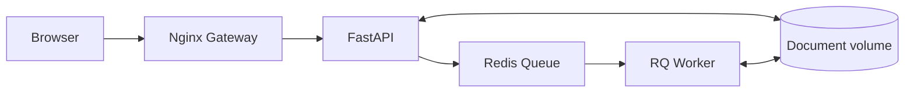
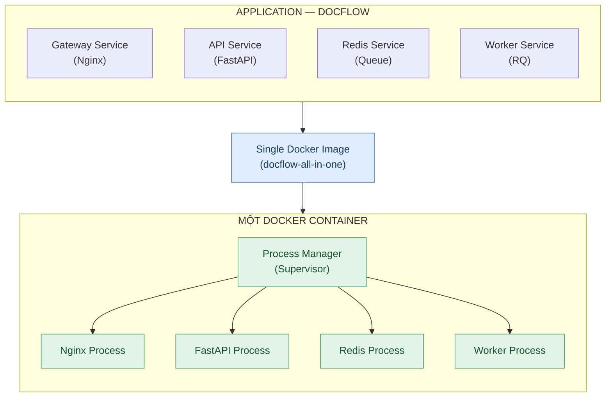

# DocFlow

[](https://github.com/TranKiet146/docflow_SOA_Seminar/actions/workflows/ci.yml)
[](https://github.com/TranKiet146/docflow_SOA_Seminar/actions/workflows/release.yml)

DocFlow là bài thực hành Docker Compose về xử lý tài liệu bất đồng bộ. Người
dùng tải file `.txt` hoặc `.md`; API đưa công việc vào Redis Queue; Worker xử
lý và tạo báo cáo JSON/HTML.

Đã cài Docker Desktop
nhưng chưa chạy dự án. Tất cả lệnh được thực hiện bằng **PowerShell**.

Phiên bản hiện tại: **v0.5.0**

## Kiến trúc



| Service   | Nhiệm vụ                           | Truy cập từ máy host |
| --------- | ---------------------------------- | -------------------- |
| `gateway` | Giao diện web và reverse proxy     | `127.0.0.1:8080`     |
| `api`     | Kiểm tra file, tạo và theo dõi job | Qua Gateway          |
| `redis`   | Queue và trạng thái job            | Không công khai      |
| `worker`  | Xử lý tài liệu, tạo báo cáo        | Không công khai      |

Chỉ Gateway công khai cổng. API, Redis và Worker trao đổi qua Docker network.

## 1. Chuẩn bị Docker

1. Mở Docker Desktop.
2. Chờ Docker Engine chạy xong.
3. Trong VS Code, chọn **Terminal → New Terminal** rồi chạy:

```powershell
docker --version
docker compose version
docker info
```

**Hoàn thành khi:** cả ba lệnh chạy thành công và `docker info` hiển thị phần
`Server`.

> Dự án không yêu cầu cài Python, Redis hoặc Nginx trên Windows.

## 2. Lấy mã nguồn

Kiểm tra Git:

```powershell
git --version
```

Nếu lệnh chưa tồn tại, cài [Git for Windows](https://git-scm.com/downloads/win)
rồi mở lại VS Code.

Nếu chưa có repository trên máy:

```powershell
git clone https://github.com/TranKiet146/docflow_SOA_Seminar.git
cd .\docflow_SOA_Seminar
code .
```

Nếu đã tải repository, mở thư mục đó trong VS Code và kiểm tra:

```powershell
git status
Get-Location
```

**Hoàn thành khi:** terminal đang ở thư mục `docflow_SOA_Seminar` và
`git status` không báo lỗi.

## 3. Tạo cấu hình môi trường

```powershell
Copy-Item .env.example .env
docker compose config --quiet
```

Giữ nguyên `.env` cho lần chạy đầu:

```dotenv
APP_PORT=8080
REDIS_URL=redis://redis:6379/0
QUEUE_NAME=document-jobs
UPLOAD_DIR=/data/uploads
RESULT_DIR=/data/results
MAX_UPLOAD_MB=2
JOB_TIMEOUT_SECONDS=60
RESULT_TTL_SECONDS=86400
```

Không đổi `REDIS_URL` thành `localhost`; `redis` là tên service trong Compose.

**Hoàn thành khi:** file `.env` tồn tại và `docker compose config --quiet`
không in lỗi.

## 4. Build và khởi động hệ thống

```powershell
docker compose up -d --build
docker compose ps
```

Lần build đầu có thể mất vài phút. Trạng thái mong đợi:

| Service   | Trạng thái |
| --------- | ---------- |
| `gateway` | `healthy`  |
| `api`     | `healthy`  |
| `redis`   | `healthy`  |
| `worker`  | `Up`       |

Worker không có healthcheck riêng nên trạng thái `Up` là đúng. Nếu service còn
`health: starting`, chờ khoảng 10 giây rồi chạy lại `docker compose ps`.

**Hoàn thành khi:** đủ bốn service đang chạy và không service nào có trạng thái
`unhealthy`, `exited` hoặc `restarting`.

## 5. Kiểm tra ứng dụng

Mở giao diện và Swagger UI:

```powershell
Start-Process http://localhost:8080
Start-Process http://localhost:8080/docs
```

Kiểm tra Gateway và API:

```powershell
(Invoke-WebRequest http://localhost:8080/health).Content
Invoke-RestMethod http://localhost:8080/api/info
```

Kết quả cần có:

```text
gateway ok
service : docflow-api
version : 0.5.0
```

**Hoàn thành khi:** giao diện, Swagger UI, `/health` và `/api/info` đều truy
cập được.

## 6. Chạy một job hoàn chỉnh

Tạo file thử nghiệm:

```powershell
@"
# DocFlow sample

Docker Compose starts the services.
Redis stores queued jobs.
The Worker processes documents in the background.
"@ | Set-Content -Encoding utf8 .\docflow-sample.md
```

Tại `http://localhost:8080`:

1. Chọn file `docflow-sample.md`.
2. Gửi file để xử lý.
3. Chờ trạng thái job chuyển từ `queued` sang `finished`.
4. Kiểm tra kết quả JSON.
5. Tải báo cáo HTML.

**Hoàn thành khi:** job có trạng thái `finished`, kết quả JSON hiển thị và file
HTML tải được.

## 7. Chạy kiểm thử tự động

```powershell
docker compose --profile test run --rm smoke-test
```

Smoke test kiểm tra Gateway, API, network isolation, upload, Redis Queue,
Worker, kết quả JSON và báo cáo HTML.

**Hoàn thành khi:** dòng cuối là:

```text
[smoke-test] ALL SMOKE TESTS PASSED
```

File kiểm thử của dự án là `tests/tests.py`.

## 8. Kiểm tra khả năng phục hồi

### Worker recovery

```powershell
powershell -ExecutionPolicy Bypass `
  -File .\scripts\test-recovery.ps1
```

**Hoàn thành khi:** dòng cuối là:

```text
ALL WORKER RECOVERY TESTS PASSED
```

### Redis recovery

```powershell
powershell -ExecutionPolicy Bypass `
  -File .\scripts\test-redis-recovery.ps1
```

**Hoàn thành khi:** dòng cuối là:

```text
ALL REDIS RECOVERY TESTS PASSED
```

Sau hai bài test, xác nhận hệ thống đã phục hồi:

```powershell
docker compose ps
```

## 9. Scale Worker

Tăng lên ba Worker:

```powershell
docker compose up -d --scale worker=3
docker compose ps
```

**Hoàn thành khi:** danh sách có `worker-1`, `worker-2`, `worker-3` và cả ba đều
`Up`.

Đưa hệ thống về một Worker:

```powershell
docker compose up -d --scale worker=1
```

## 10. Chạy image phát hành

Bước này kiểm tra các image do quy trình CD phát hành lên GHCR, không build từ
mã nguồn local.

```powershell
docker compose down
$env:DOCFLOW_VERSION = "0.5.0"

docker compose `
  -f compose.yaml `
  -f compose.release.yaml `
  pull gateway api worker

docker compose `
  -f compose.yaml `
  -f compose.release.yaml `
  up -d --no-build

docker compose `
  -f compose.yaml `
  -f compose.release.yaml `
  ps
```

Chạy lại smoke test trên bản release:

```powershell
docker compose `
  -f compose.yaml `
  -f compose.release.yaml `
  --profile test `
  run --rm smoke-test
```

**Hoàn thành khi:** ba service có healthcheck đều `healthy`, Worker `Up` và
smoke test báo `ALL SMOKE TESTS PASSED`.

Images của release `v0.5.0`:

```text
ghcr.io/trankiet146/docflow-backend:0.5.0
ghcr.io/trankiet146/docflow-gateway:0.5.0
```

## 11. Dừng và dọn môi trường

Dừng và xóa container/network, giữ dữ liệu trong volume:

```powershell
docker compose down
```

Xóa cả dữ liệu Redis, file upload và báo cáo:

```powershell
docker compose down --volumes
```

> Chỉ dùng `--volumes` khi muốn reset toàn bộ dữ liệu.

**Hoàn thành khi:** `docker compose ps` không còn service đang chạy.

## Tiêu chí hoàn thành toàn bộ bài thực hành

- [ ] Docker Engine hoạt động.
- [ ] Bốn service khởi động đúng trạng thái.
- [ ] Upload tài liệu và nhận báo cáo thành công.
- [ ] Smoke test vượt qua.
- [ ] Worker recovery và Redis recovery vượt qua.
- [ ] Scale từ một lên ba Worker rồi đưa về một Worker thành công.
- [ ] Bản release `v0.5.0` chạy bằng image từ GHCR và vượt qua smoke test.
- [ ] Môi trường được dừng đúng cách.

## CI/CD

| Workflow                                                                               | Kích hoạt          | Kết quả                         |
| -------------------------------------------------------------------------------------- | ------------------ | ------------------------------- |
| [CI](https://github.com/TranKiet146/docflow_SOA_Seminar/actions/workflows/ci.yml)      | Push/PR vào `main` | Build và chạy integration test  |
| [CD](https://github.com/TranKiet146/docflow_SOA_Seminar/actions/workflows/release.yml) | Push tag `v*.*.*`  | Build và publish image lên GHCR |

CD của dự án là **Continuous Delivery**: image được phát hành tự động, còn việc
triển khai được thực hiện bằng lệnh ở bước 10.

## Chẩn đoán nhanh

### Docker Engine chưa chạy

```powershell
docker info
```

Nếu không có phần `Server`, mở Docker Desktop và chờ Engine sẵn sàng.

### Có service lỗi

```powershell
docker compose ps
docker compose logs --tail=100
```

Xem riêng một service:

```powershell
docker compose logs gateway
docker compose logs api
docker compose logs redis
docker compose logs worker
```

### Cổng 8080 đã được sử dụng

Đổi trong `.env`:

```dotenv
APP_PORT=8081
```

Sau đó tạo lại Gateway:

```powershell
docker compose up -d --force-recreate gateway
```

Truy cập `http://localhost:8081`.

### Gateway báo `unhealthy`

```powershell
docker compose exec gateway `
  wget -qO- http://127.0.0.1/health
```

Kết quả đúng là `gateway ok`.

## Cấu trúc chính

```text
backend/                   FastAPI và RQ Worker
gateway/                   Nginx và giao diện web
tests/tests.py             Smoke test end-to-end
scripts/                   Worker/Redis recovery tests
.github/workflows/         CI và CD
compose.yaml               Cấu hình chạy local
compose.release.yaml       Image phát hành từ GHCR
```

## Tài liệu bổ sung

- [Kiến trúc hệ thống](docs/architecture.md)
- [Kịch bản demo seminar](docs/demo.md)
- [Tiến độ dự án](docs/progress.md)
- [Phạm vi dự án](docs/scope.md)

## Trạng thái dự án

Đã hoàn thành Docker Compose multi-container, upload/queue/worker, persistent
volumes, network isolation, healthchecks, recovery tests, horizontal scaling,
CI, CD và release `v0.5.0`.

Phạm vi không bao gồm authentication, xử lý PDF/Office, Kubernetes, multi-host
deployment và automatic production deployment.

## Presentation Diagram:


