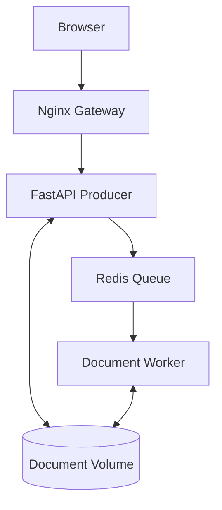
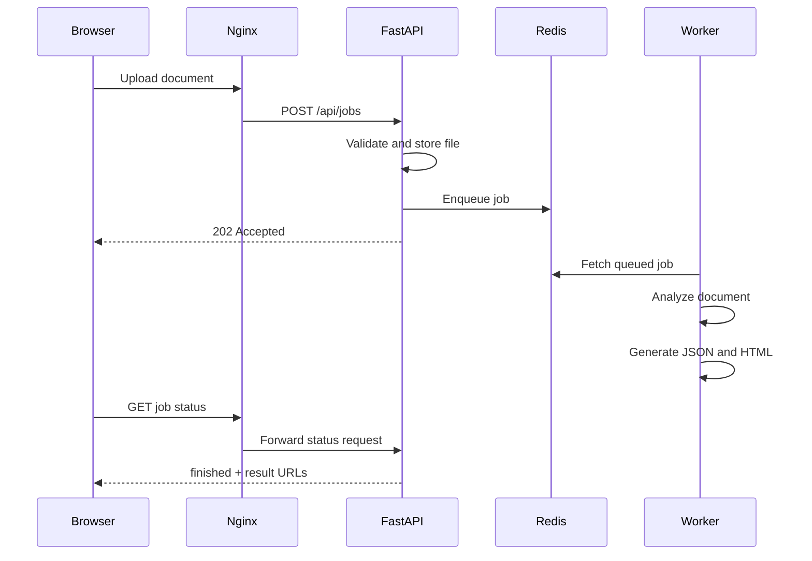

# DocFlow architecture

## 1. System overview

DocFlow follows a Producer–Queue–Consumer architecture.



The browser never communicates directly with FastAPI, Redis or the Worker.

## 2. Request flow



The API returns `202 Accepted` because processing occurs asynchronously.

## 3. Service responsibilities

### Nginx Gateway

- Publishes port `8080`
- Serves the browser interface
- Reverse-proxies `/api` to FastAPI
- Provides the public health endpoint
- Hides internal service addresses

### FastAPI

- Validates file extension and size
- Stores uploaded documents
- Creates job identifiers
- Enqueues jobs in Redis
- Exposes status and result endpoints
- Reports dependency readiness

### Redis Queue

- Stores queued job information
- Decouples API requests from processing
- Preserves work while the Worker is unavailable
- Coordinates job state between API and Worker

### Worker

- Consumes jobs from Redis Queue
- Reads documents from the shared volume
- Calculates document statistics
- Generates JSON and HTML reports
- Updates progress and final job state

## 4. Networks

| Network    | Connected services | Purpose                  |
| ---------- | ------------------ | ------------------------ |
| `edge-net` | Gateway, API       | Public request path      |
| `job-net`  | API, Redis, Worker | Internal processing path |

`job-net` is configured as an internal Docker network.

The Gateway cannot resolve Redis because they do not share a network.

FastAPI joins both networks and acts as the controlled boundary between
public traffic and internal processing.

## 5. Storage

| Volume          | Used by     | Purpose                    |
| --------------- | ----------- | -------------------------- |
| `redis-data`    | Redis       | Redis persistence          |
| `document-data` | API, Worker | Uploaded files and reports |

The API writes uploads to `/data/uploads`.

The Worker writes reports to `/data/results`.

## 6. Health model

### Liveness

The API liveness endpoint proves the process is running:

```text
GET /health/live
```

### Readiness

The API readiness endpoint checks Redis connectivity:

```text
GET /health/ready
```

If Redis is unavailable, readiness returns `503 Service Unavailable`.

### Gateway health

Nginx exposes:

```text
GET /health
```

The container healthcheck uses `127.0.0.1` to avoid IPv6 resolution of
`localhost` inside Alpine.

## 7. Failure scenarios

### Worker unavailable

The API continues accepting requests. Jobs remain in Redis with the `queued`
status. After the Worker restarts, it processes the existing jobs.

### Redis unavailable

The API remains alive but is not ready. New enqueue attempts return `503`.
After Redis restarts, readiness and document processing recover.

### Gateway unavailable

Internal containers may still be running, but no public request path is
available. Restarting the Gateway restores access without changing queued
jobs or stored documents.

## 8. Scaling

Workers are stateless consumers. Additional Worker containers can consume
from the same Redis queue:

```bash
docker compose up -d --scale worker=3
```

No additional host ports are required.

## 9. Design principles demonstrated

- Separation of concerns
- Loose coupling
- Asynchronous processing
- Service discovery
- Network segmentation
- Persistent storage
- Health and readiness checks
- Failure recovery
- Horizontal scaling
- Automated integration testing
